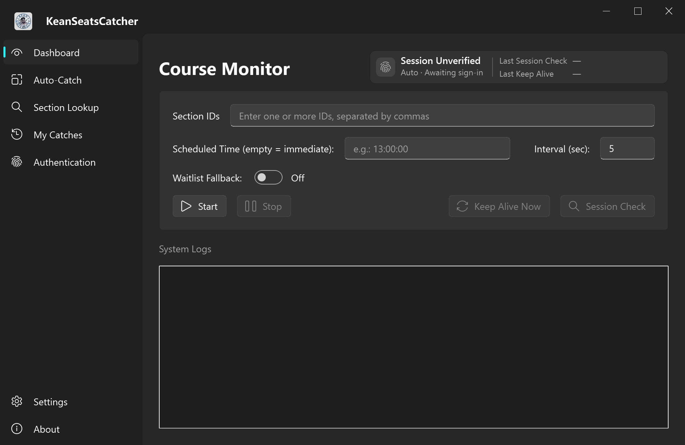
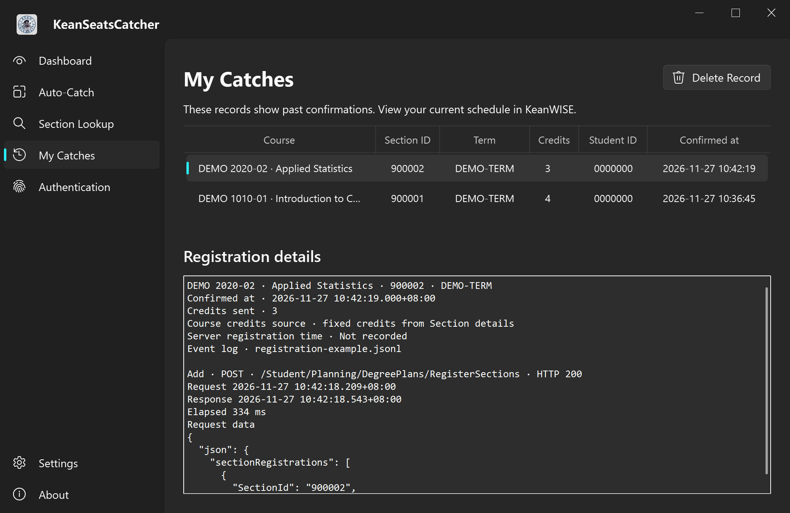
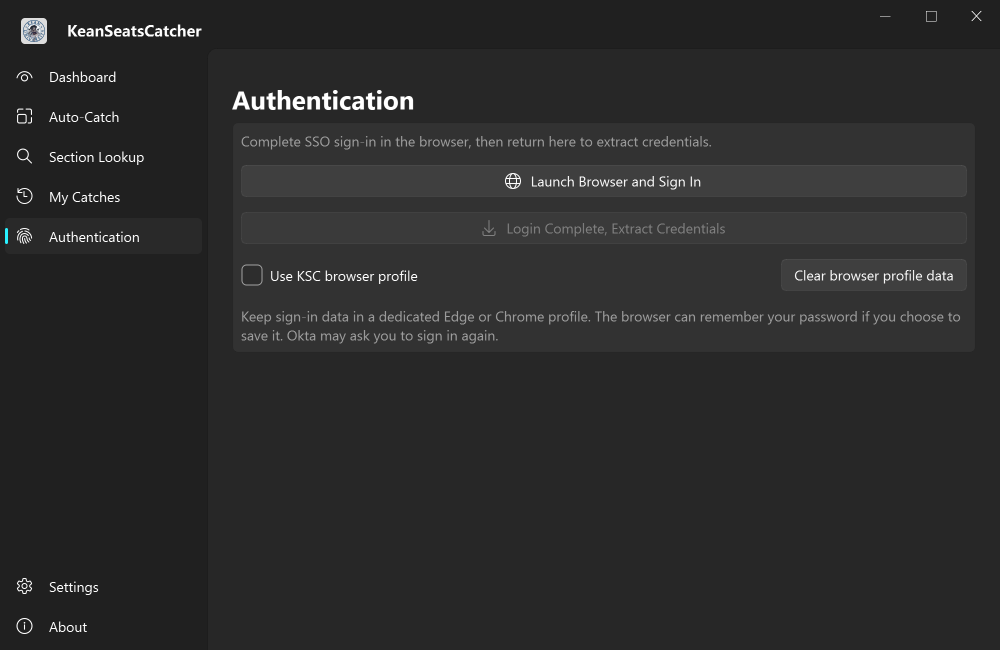

<p align="center"></p>
<h1 align="center">KeanSeatsCatcher</h1>

KeanSeatsCatcher is Limitime's course registration tool for KeanWISE Self-Service.
Look up sections, schedule a registration attempt, or watch for an opening.
The Windows app has an English and a Simplified Chinese interface. Cloud Phantom
is the command-line version of Auto-Catch.

<p align="center"></p>

## Download

Get the Windows x64 build from the [latest release](../../releases/latest). Both
downloads include Python and Qt and require Windows 10 version 1809 or later.
Sign-in on Windows uses Microsoft Edge or Google Chrome.

| Download | What to run |
| --- | --- |
| Portable | Run `KeanSeatsCatcher_v1.4.0_Portable.exe` directly. |
| Setup | Run `KeanSeatsCatcher_v1.4.0_Setup.exe` for a Start menu shortcut, optional desktop shortcut, and uninstaller. |

Both builds use the same [application data folder](#application-data).

## Using the desktop app

1. Open **Authentication** and click **Launch Browser and Sign In**. Sign in to
   KeanWISE in the browser, including any Okta prompts. Once **Degree Plans**
   opens, return to KSC and click **Login Complete, Extract Credentials**.
2. Enter the numeric **Section IDs** from KeanWISE, separated by commas. Use
   **Section Lookup** to check the course, term, credits, seats, waitlist and
   your registration status before starting a task.
3. Choose **Dashboard** or **Auto-Catch**. Only one registration task runs at
   a time.

| Page | What it does |
| --- | --- |
| **Dashboard** | Submits the first registration request at **Scheduled Time** and checks the outcome. Leave the time blank to start immediately. The time is interpreted as today's local time in 24-hour format. A past or invalid time also starts immediately. The interval controls subsequent attempts. |
| **Auto-Catch** | Checks availability at the chosen interval and submits for eligible sections as it finds them. **Drop Section ID** is optional and requests a drop alongside the add. |
| **My Catches** | Shows past registrations that KSC submitted and then verified. Select a record to see the request, response and timing, filter by account, or delete the local record. KeanWISE shows your current schedule. |

**Waitlist Fallback** can request a waitlist spot after a section-specific
Closed rejection and a schedule read confirming the target is still unregistered.
Check both sections in KeanWISE after a swap because the server can apply only
part of the request.

<details>
<summary>My Catches with example records</summary>



</details>

### Sessions and browser profiles

The **Session Status** summary on Dashboard and Auto-Catch shows the session,
the keepalive countdown, and the latest check and keepalive outcomes.
**Dashboard** has separate **Session Check** and **Keep Alive Now** buttons.
A session check reports **Valid**, **Expired**, or **Unknown**. When an account
needs to sign in again, use **Authentication**. You can refresh credentials
for the same account while the Dashboard is still counting down.

**Automatic Keepalive** is on by default at 10 minutes. In **Settings**, choose
5, 10, or 15 minutes or turn it off. Recent authenticated traffic can postpone a
check. Maintenance waits during active registration and observes server
cooldowns. If it confirms expiry, KSC tries one verified recovery for the same
account. Be ready to sign in again if Okta asks for a password or MFA.
**Show Session Status** in Settings controls the summary on both pages.

Enable **Use KSC browser profile** in **Authentication** if you want to reuse
sign-in data. KSC uses separate Edge and Chrome profiles in its data folder.
The browser's password manager handles any password you choose to save. With
**Keep Browser Open** on, an open KSC profile browser can be reused until you
close it or exit KSC. **Clear browser profile data** closes that browser and
deletes cookies, site data and saved passwords in the dedicated profiles,
including retained legacy profiles. The default is a temporary browser profile.

<details>
<summary>Authentication</summary>



</details>

## Application data

Open **Settings → Open Application Data Folder** to find the active folder.
On Windows it defaults to `%LOCALAPPDATA%\KeanSeatsCatcher`. Moving or
replacing Portable, switching between Portable and Setup, and uninstalling
the app through Setup preserve this folder.

| Path | Contents |
| --- | --- |
| `config.json` | Language, browser, keepalive and session display settings. |
| `catches.sqlite3` | Verified catch history and its supporting request evidence. |
| `logs/` | Registration events as JSON Lines. The CLI also writes `cloud_sniper.log`. |
| `browser-profiles/` | Optional KSC-managed Edge and Chrome profiles. |

For the first upgrade, close the old app and its KSC browser. If you used an
older Portable build, run v1.4.0 once from the directory containing the old
`config.json`. KSC imports that file when the new folder has no configuration.
It also merges catch history from `~/.keanseatscatcher`, copies logs, and copies
each missing browser profile as a unit. Existing settings and profiles take
precedence. The old files stay on disk.

Set `KSC_DATA_DIR` to use a separate data folder or `KSC_LOG_DIR` to redirect
logs. The CLI defaults to `~/Library/Application Support/KeanSeatsCatcher` on
macOS and `$XDG_DATA_HOME/KeanSeatsCatcher` or
`~/.local/share/KeanSeatsCatcher` on Linux. Keep the data folder private.
Registration evidence can still contain student IDs and course records after
credential redaction. The CLI logs the webhook URL if one is configured.
Browser profiles may contain active sessions and saved passwords.

## Cloud Phantom

The CLI in this repository can run Auto-Catch without the desktop app. On a
machine with a browser and display, use Python 3.10 or later and export a
session after signing in to KeanWISE.

```sh
python -m pip install -r requirements-cli.txt selenium
python export_session.py --output session.json
```

`session.json` contains live cookies, a request verification token and your
student ID in plain JSON. Keep it private. On the machine running the CLI,
install the CLI dependencies and use your exported file. Replace `12345,67890`
with your section IDs.

```sh
python -m pip install -r requirements-cli.txt
python cloud_cli.py --load-session session.json --sections 12345,67890 --verify-only
python cloud_cli.py --load-session session.json --sections 12345,67890 --interval 15
```

Use `--verify-only` to read the schedule and exit. The last command starts a
registration task. `--waitlist` enables the same fallback as
the desktop app. `--webhook URL` sends a JSON object with `title` and `message`
when all targets are confirmed. `--drop-section ID` is the CLI equivalent
of **Drop Section ID**. With Selenium and a display, `--no-headless` lets you
sign in from the CLI instead of loading an exported session.

For Docker, put `session.json` next to `docker-compose.yml`, edit the section
IDs in the service command, and run `docker compose up --build -d`. Use
`docker compose logs -f` for output and `docker compose down` to stop.
Compose mounts the session read-only and keeps data under the host's `./logs`
directory. A worker using an exported session stops on confirmed expiry.
Export a fresh session and start the task again when needed.

## How it works

The desktop app uses PyQt6 and QFluentWidgets. Its Dashboard and Auto-Catch
workers use Qt threads. The CLI uses a Python thread and the same
`requests`-based client. Selenium handles browser sign-in. Subsequent course
and schedule requests use the signed-in account's session.

KSC uses the Ellucian Colleague data behind KeanWISE Self-Service. It resolves
each section's term and uses the account's Degree Plans records to verify
registration. A full section, a waitlist spot, a request acknowledgement, and
a verified registration are distinct outcomes. Ambiguous writes stay
**Unknown** while KSC checks the account records before deciding whether to
retry. KeanWISE determines eligibility and the final outcome.

- [Registration verification and the evidence behind it](docs/Registration-Verification.md)
- [KeanWISE session lifecycle study](docs/Session-Lifecycle-Study-v1.3.3.md)
- [Kean Registrar's description of Self-Service](https://www.kean.edu/offices/registrars-office/registrar-resources-faculty-and-advisors)

## Run from source

On Windows, run these from the repository root with 64-bit Python 3.10 or
later.

```powershell
python -m venv .venv
.\.venv\Scripts\python.exe -m pip install -r requirements.txt
.\.venv\Scripts\python.exe ui_main.py
```

See the [Windows build and source notes](docs/Windows-Build.md) for packaging.

Use KSC with your own account and follow your institution's rules on
registration and automated requests. The software comes without a warranty.

Original project code is [MIT-licensed](LICENSE). The Windows builds include
GPL-licensed Qt bindings and widgets.
See the [binary licensing and upstream sources](docs/Windows-Build.md#source-and-licenses).

Maintained by Limitime. [GitHub](https://github.com/Daozhu1007) · [Bilibili](https://space.bilibili.com/477852567)
